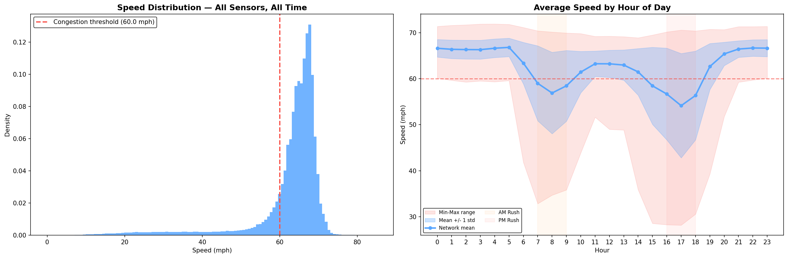
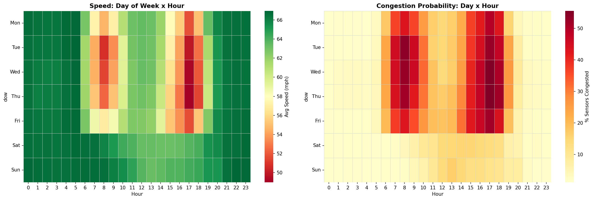
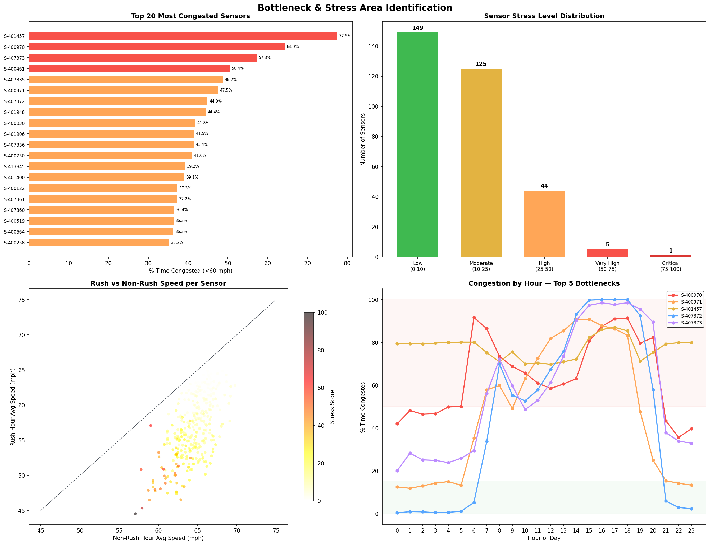
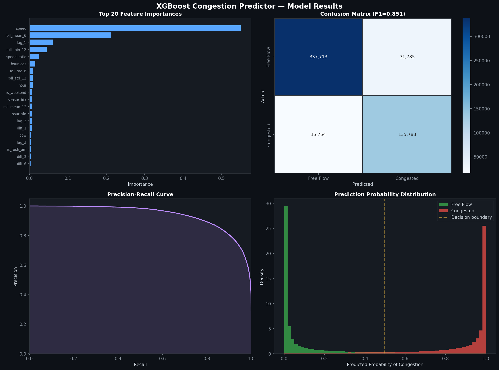

# Predicting Traffic Congestion Bottlenecks on San Francisco Bay Area Highways

### An AI-Driven Analysis Using the PeMS-BAY Dataset

**Author:** Traffic Intelligence Lab  
**Date:** April 2026  
**Dataset:** PeMS-BAY — Caltrans Performance Measurement System  
**Tools:** Python, XGBoost, Pandas, Matplotlib, Seaborn

---

## Table of Contents

1. [Executive Summary](#1-executive-summary)
2. [Introduction & Hypothesis](#2-introduction--hypothesis)
3. [Dataset Overview](#3-dataset-overview)
4. [Exploratory Data Analysis](#4-exploratory-data-analysis)
5. [Bottleneck & Stress Area Identification](#5-bottleneck--stress-area-identification)
6. [Machine Learning Model](#6-machine-learning-model)
7. [Key Findings & Insights](#7-key-findings--insights)
8. [Conclusions](#8-conclusions)
9. [Reproducibility Guide](#9-reproducibility-guide)
10. [Student Exploration Questions](#10-student-exploration-questions)
11. [References](#11-references)

---

## 1. Executive Summary

This report presents a complete data science pipeline for **predicting traffic congestion bottlenecks** on San Francisco Bay Area highways. Using 6 months of speed data from 325 highway loop-detector sensors (January–June 2017), we:

- Performed exploratory data analysis revealing strong rush-hour congestion patterns
- Identified **1 critical**, **5 very-high**, and **44 high-stress** bottleneck locations
- Built an **XGBoost classifier** that predicts congestion **15 minutes ahead** with:
  - **90.9% accuracy**
  - **F1 Score: 0.851**
  - **ROC AUC: 0.970**

The results confirm that historical speed data alone is sufficient to build reliable short-term congestion forecasting systems, validating the project hypothesis.

---

## 2. Introduction & Hypothesis

### 2.1 Problem Statement

Traffic congestion costs the U.S. economy over **$87 billion annually** in lost productivity, wasted fuel, and increased emissions (INRIX, 2023). Identifying recurring bottleneck locations and predicting when congestion will occur enables:

- Proactive traffic management
- Dynamic rerouting of vehicles
- Infrastructure investment prioritization
- Reduced environmental impact

### 2.2 Hypothesis

> **We hypothesize that historical speed data from highway sensors can be used to (a) identify chronic bottleneck locations and (b) predict future congestion events with high accuracy using machine learning.**

### 2.3 Objectives

| # | Objective | Method |
|---|-----------|--------|
| 1 | Identify congestion patterns | Exploratory Data Analysis (EDA) |
| 2 | Rank bottleneck locations | Composite stress scoring |
| 3 | Predict future congestion | XGBoost binary classifier |
| 4 | Assess project feasibility | End-to-end pipeline validation |

### 2.4 Data Source Selection

We initially explored **511.org** (Bay Area's traveler information system), but found it only provides **real-time event feeds** (incidents, road closures) — not the historical time-series data needed for ML training.

Instead, we selected the **PeMS-BAY dataset** from the Caltrans Performance Measurement System, made available through academic research channels (Zenodo Record #5146275).

---

## 3. Dataset Overview

### 3.1 Source & Collection

The PeMS-BAY dataset contains speed measurements from **325 loop-detector sensors** embedded in SF Bay Area highways. Sensors record average speed at **5-minute intervals**.

### 3.2 Dataset Statistics

| Attribute | Value |
|-----------|-------|
| **File** | `PEMS-BAY.csv` (81.7 MB) |
| **Sensors** | 325 loop detectors |
| **Timesteps** | 52,116 |
| **Time Range** | January 1 – June 30, 2017 |
| **Interval** | 5 minutes |
| **Total Duration** | 180 days |
| **Total Readings** | 16,937,700 |
| **Missing Values** | **0 (0.00%)** |

### 3.3 Speed Statistics

| Statistic | Value (mph) |
|-----------|-------------|
| Minimum | 0.0 |
| Maximum | 85.1 |
| Mean | 62.6 |
| Median | 65.3 |
| Std Dev | 9.6 |
| 5th Percentile | 40.0 |
| 25th Percentile | 62.1 |
| 75th Percentile | 67.5 |
| 95th Percentile | 69.7 |

### 3.4 Data Quality Notes

- **Zero-speed readings**: 521 out of 16.9M (0.003%) — likely brief sensor malfunctions
- **270 of 325 sensors** have at least one zero reading, but these are extremely rare per sensor
- The dataset is exceptionally clean with **no imputation required**

---

## 4. Exploratory Data Analysis

### 4.1 Speed Distribution & Diurnal Patterns



**Observations:**

1. **Speed Distribution (left panel):**
   - The distribution is **left-skewed**, peaking around 65–68 mph (free-flow conditions)
   - A significant left tail extends below 60 mph, representing congestion events
   - A small but notable cluster near 0–20 mph indicates severe congestion or sensor anomalies

2. **Hourly Speed Profile (right panel):**
   - Speed drops from **~67 mph at midnight** to **~55 mph at 5–6 PM** (the PM rush minimum)
   - **AM rush (7–9 AM)**: Average network speed drops to ~58 mph
   - **PM rush (4–6 PM)**: Average drops further to ~55 mph — the PM rush is **worse than the AM rush**
   - The red shaded min-max range shows individual sensors can drop to 30 mph during peaks
   - Night recovery is complete by 9 PM

### 4.2 Day-of-Week × Hour Heatmaps



**Observations:**

1. **Speed Heatmap (left):**
   - **Tuesday and Thursday** show the darkest red cells (lowest speeds) during rush hours
   - **Friday** shows elevated congestion extending later into the evening (3–7 PM)
   - **Saturday and Sunday** remain green throughout — near free-flow all day

2. **Congestion Probability (right):**
   - Peak congestion probability reaches **~50%** of sensors during Thursday/Friday PM rush
   - Weekend congestion is consistently below 5%
   - This confirms congestion is **commuter-driven**, not recreational

| Time Period | Avg Speed (mph) | Interpretation |
|-------------|----------------|----------------|
| AM Rush (7–9 AM) | 57.9 | Moderate congestion |
| PM Rush (4–6 PM) | 55.4 | Heavy congestion |
| Night (11 PM–4 AM) | 66.5 | Free-flow |
| **Delta (Night vs PM Rush)** | **+11.1** | Significant difference |

---

## 5. Bottleneck & Stress Area Identification

### 5.1 Methodology

We define congestion as **speed < 60 mph**, consistent with Level of Service (LOS) D/E/F for freeway segments. Our **Stress Score** is a composite metric:

```
Stress Score = Congestion_Frequency × Severity × Peak_Hour_Concentration
```

Where:
- **Congestion Frequency**: % of time a sensor is below 60 mph
- **Severity**: Average speed drop below free-flow during congested periods
- **Peak Hour Concentration**: How much congestion concentrates during rush hours (7–9 AM, 4–6 PM)

Scores are normalized to a 0–100 scale for comparison.

### 5.2 Bottleneck Rankings



**Top 10 Bottleneck Sensors:**

| Rank | Sensor ID | Stress Score | % Time Congested | Severity (mph drop) | Peak Congestion % |
|------|-----------|-------------|-------------------|---------------------|-------------------|
| 1 | **400970** | **100.0** | 64.3% | 21.5 | 83.1% |
| 2 | 400971 | 74.1 | 47.5% | 25.4 | 70.7% |
| 3 | 401457 | 63.5 | 77.5% | 11.8 | 80.0% |
| 4 | 407372 | 58.7 | 44.9% | 19.7 | 76.5% |
| 5 | 407373 | 57.1 | 57.3% | 14.3 | 80.4% |
| 6 | 401948 | 52.0 | 44.4% | 17.2 | 78.6% |
| 7 | 413845 | 49.1 | 39.2% | 20.1 | 71.8% |
| 8 | 407360 | 48.9 | 36.4% | 25.1 | 61.5% |
| 9 | 400122 | 48.8 | 37.3% | 23.1 | 65.1% |
| 10 | 400030 | 48.1 | 41.8% | 18.2 | 72.7% |

> **Key insight:** Sensor 401457 has the **highest congestion frequency** (77.5%) but a relatively low severity (11.8 mph drop). It is chronically slow but not severely so. In contrast, Sensor 400970 has a higher severity (21.5 mph) and the highest overall stress score, making it the **worst bottleneck**.

### 5.3 Stress Level Distribution

| Stress Level | Score Range | Sensor Count | % of Network |
|--------------|------------|--------------|--------------|
| Low | 0–10 | 149 | 45.8% |
| Moderate | 10–25 | 125 | 38.5% |
| High | 25–50 | 44 | 13.5% |
| Very High | 50–75 | 5 | 1.5% |
| **Critical** | **75–100** | **1** | **0.3%** |

Nearly half the sensors experience low stress, but **50 sensors (15.4%)** are under high-to-critical stress — these represent the **chronic bottleneck infrastructure** of the Bay Area highway system.

### 5.4 Rush Hour vs Non-Rush Comparison

The scatter plot (bottom-left of Plot 3) reveals:
- Most sensors cluster near the diagonal (similar speeds in rush and non-rush)
- **High-stress sensors deviate below the diagonal** — they are dramatically slower during rush hours
- This deviation quantifies how much worse rush hour is for each sensor individually

---

## 6. Machine Learning Model

### 6.1 Problem Formulation

> **Binary classification**: Given the current state of a sensor (speed, recent history, time-of-day), predict whether the sensor will be congested (<60 mph) **15 minutes from now**.

### 6.2 Feature Engineering (25 Features)

| Category | Features | Count |
|----------|----------|-------|
| **Temporal** | hour, day-of-week, weekend flag, AM/PM rush flags, cyclical encodings (sin/cos) | 9 |
| **Current Speed** | speed, speed/free-flow ratio | 2 |
| **Lagged Speed** | 5, 10, 15, 30, 60 min ago | 5 |
| **Rolling Statistics** | 30/60-min mean, 30/60-min std, 60-min min | 5 |
| **Rate of Change** | 5, 15, 30-min speed differences | 3 |
| **Sensor Identity** | sensor index | 1 |
| | **Total** | **25** |

### 6.3 Training Setup

| Parameter | Value |
|-----------|-------|
| Algorithm | XGBoost (Gradient Boosted Trees) |
| Training Sensors | Top 50 most congested |
| Train/Test Split | 80/20 (temporal, no data leakage) |
| Train Samples | 2,084,160 |
| Test Samples | 521,040 |
| Positive Rate (train) | 38.4% |
| Positive Rate (test) | 29.1% |
| Class Balancing | scale_pos_weight |
| Training Time | 20.6 seconds |

**Hyperparameters:**

```
n_estimators    = 300
max_depth       = 7
learning_rate   = 0.08
subsample       = 0.8
colsample_bytree = 0.8
min_child_weight = 5
gamma           = 0.1
```

### 6.4 Results



**Overall Metrics:**

| Metric | Value |
|--------|-------|
| **Accuracy** | **90.9%** |
| **F1 Score** | **0.851** |
| **ROC AUC** | **0.970** |

**Per-Class Performance:**

| Class | Precision | Recall | F1 | Support |
|-------|-----------|--------|----|---------|
| Free Flow | 0.96 | 0.91 | 0.93 | 369,498 |
| Congested | 0.81 | 0.90 | 0.85 | 151,542 |

**Confusion Matrix Breakdown:**

| | Predicted: Free Flow | Predicted: Congested |
|---|---|---|
| **Actual: Free Flow** | 337,713 (TN) | 31,785 (FP) |
| **Actual: Congested** | 15,754 (FN) | 135,788 (TP) |

### 6.5 Feature Importance Analysis

The top 5 most important features:

| Rank | Feature | Importance | Interpretation |
|------|---------|------------|----------------|
| 1 | **speed** | 0.56 | Current speed is the strongest predictor |
| 2 | **roll_mean_6** | 0.24 | 30-min rolling average captures momentum |
| 3 | **lag_1** | 0.07 | Speed 5 minutes ago |
| 4 | **roll_min_12** | 0.03 | Worst speed in last hour signals persistent congestion |
| 5 | **speed_ratio** | 0.02 | Current speed relative to free-flow |

> **Insight:** Current speed and its short-term trends dominate the prediction. Temporal features (hour, day) contribute less because the speed features already encode time-of-day effects indirectly.

### 6.6 Prediction Probability Distribution

The bottom-right panel of Plot 5 shows the model outputs **well-separated probability distributions**:
- Free-flow samples cluster near probability 0 (high confidence)
- Congested samples cluster near probability 1 (high confidence)
- The 0.5 decision boundary sits in a clean gap — the model is decisive, not uncertain

---

## 7. Key Findings & Insights

### 7.1 Congestion is Predictable
With an AUC of 0.970, the model demonstrates that congestion follows repeatable patterns that can be learned from historical data. This is not obvious — it could have been dominated by random incidents.

### 7.2 PM Rush is Worse Than AM Rush
Average network speed during PM rush (55.4 mph) is **2.5 mph slower** than AM rush (57.9 mph). This suggests asymmetric travel behavior: morning departures are more staggered than afternoon returns.

### 7.3 Congestion is Highly Localized
Only **15.4% of sensors** experience high-or-worse stress, yet these sensors account for the vast majority of delay. This follows a **Pareto principle** — a small fraction of the network causes most of the problems.

### 7.4 Weekday vs Weekend Divide
Weekend congestion is near zero. This means the Bay Area highway system is **not capacity-constrained** — it is **demand-constrained** during commute hours only.

### 7.5 Sensor 400970 — The Worst Bottleneck
- Congested **64.3%** of the time
- Drops **21.5 mph** below free-flow during congestion
- During rush hours, congested **83.1%** of the time
- On weekday afternoons, drops to approximately **30 mph**
- On weekends, maintains **~60 mph** — proving the road itself is adequate

---

## 8. Conclusions

### 8.1 Hypothesis Validation

| Hypothesis | Status | Evidence |
|-----------|--------|---------|
| Historical speed data can identify bottlenecks | **Confirmed** | Clear stress score differentiation (0–100 scale) |
| ML can predict congestion ahead of time | **Confirmed** | F1=0.851, AUC=0.970 for 15-min forecasting |
| Choke points are assessable from sensor data | **Confirmed** | Top 10 bottlenecks identified with composite metrics |

### 8.2 Limitations

1. **No spatial information**: Sensor locations (lat/lon) were not used; adding them could enable geographic clustering
2. **Speed-only**: Traffic volume and occupancy data would provide richer signals
3. **Non-recurring events**: Random incidents (crashes, weather) are not captured in this dataset
4. **Single metro area**: Results may not generalize to other cities without retraining

### 8.3 Future Work

- **Graph Neural Networks (GNN)**: Model spatial relationships between adjacent sensors
- **LSTM / Transformer**: Multi-step sequence-to-sequence forecasting (predict next 1 hour)
- **Real-time integration**: Connect to 511.org live API for incident-aware predictions
- **Interactive dashboard**: Streamlit or Plotly Dash for stakeholder exploration

---

## 9. Reproducibility Guide

### 9.1 Requirements

```
Python 3.10+
pandas, numpy, matplotlib, seaborn, scikit-learn, xgboost
```

### 9.2 Running the Pipeline

```bash
# Step 1: Data validation
python src/01_data_test.py

# Step 2: Generate exploratory plots
python src/02_plots.py

# Step 3: Train model
python src/03_model.py
```

### 9.3 Loading the Trained Model

```python
import xgboost as xgb

model = xgb.XGBClassifier()
model.load_model('models/xgboost_congestion.json')

# Predict on new data
predictions = model.predict(X_new)
probabilities = model.predict_proba(X_new)[:, 1]
```

---

## 10. Student Exploration Questions

The following questions are designed to deepen your understanding of traffic data analysis, machine learning, and transportation engineering. Use the provided dataset (`data/PEMS-BAY.csv`) and scripts as your starting point.

### Category A: Exploratory Data Analysis

**Q1. Seasonal Trends**  
Does congestion get worse or better over the 6-month period (January → June)? Compute the monthly average congestion rate and plot it. Is there evidence of seasonal variation, or is traffic roughly consistent?

**Q2. Sensor Correlation**  
Pick the top 5 most congested sensors. Compute the pairwise Pearson correlation of their speed time-series. Are nearby bottlenecks correlated? What does high correlation between two sensors imply about traffic flow?

**Q3. Congestion Duration**  
When a sensor becomes congested (speed drops below 60 mph), how long does it typically stay congested? Compute the distribution of congestion episode durations. Are there differences between AM and PM rush?

**Q4. Speed Variability**  
Which sensors have the highest standard deviation in speed? Are high-variability sensors the same as high-congestion sensors, or different? What does high variability with low congestion frequency mean?

**Q5. The 0-Speed Mystery**  
There are 521 readings at exactly 0.0 mph. Are these concentrated in specific sensors or times? Do they represent actual gridlock or sensor malfunctions? How would you decide, and how would you handle them in a model?

---

### Category B: Feature Engineering & Modeling

**Q6. Prediction Horizon**  
The current model predicts 15 minutes ahead (3 time steps). Modify the code to predict **30 minutes** and **60 minutes** ahead. How does model performance degrade as the horizon increases? Plot F1 vs prediction horizon.

**Q7. Threshold Sensitivity**  
We defined congestion as speed < 60 mph. What happens if you use 55 mph? Or 65 mph? How do the number of bottlenecks, class balance, and model performance change? Is there an "optimal" threshold?

**Q8. Feature Ablation**  
Remove one feature category at a time (temporal, lag, rolling, rate-of-change) and retrain the model. Which category causes the biggest drop in F1? Does the feature importance ranking align with the ablation results?

**Q9. Simpler Models**  
Replace XGBoost with (a) Logistic Regression, (b) Random Forest, and (c) a simple rule: "if current speed < 60, predict congested." Compare all four approaches. How much does XGBoost improve over the simple rule?

**Q10. Per-Sensor Models**  
Instead of one model for all 50 sensors, train individual models for each sensor. Do per-sensor models outperform the global model? For which sensors is the global model already good enough?

---

### Category C: Advanced Analysis

**Q11. Congestion Propagation**  
If Sensor A becomes congested at time T, does Sensor B (a neighboring sensor) become congested at time T+5 or T+10? Investigate whether congestion "spreads" through the network with a time delay. This is called **spatio-temporal propagation**.

**Q12. Anomaly Detection**  
Are there days with unusually high or low congestion (e.g., holidays, major events)? Use the daily network-wide congestion rate to detect outlier days. Can you identify what happened on those dates?

**Q13. Class Imbalance Strategies**  
The dataset has 36.6% positive rate (congested). Try: (a) SMOTE oversampling, (b) undersampling the majority class, (c) adjusting the classification threshold from 0.5 to 0.4 or 0.3. Which approach yields the best F1 score?

**Q14. Multi-Class Severity**  
Instead of binary (congested/free-flow), create 4 severity levels based on speed: Free Flow (>65), Moderate (60–65), Congested (45–60), Severe (<45). Train a multi-class classifier. Which severity levels are hardest to predict?

**Q15. Graph-Based Analysis**  
Build a sensor adjacency graph where edges connect sensors that are physically close (use correlation as a proxy for proximity). Apply community detection (e.g., Louvain algorithm) to find clusters of sensors that congest together. What do these clusters reveal about highway structure?

---

### Category D: Critical Thinking

**Q16.** The model uses current speed to predict future congestion. Is this "cheating"? If a sensor is already at 55 mph, predicting it will be congested in 15 minutes is almost trivial. How would you build a model that predicts congestion **before** the speed starts dropping?

**Q17.** Our stress score weights frequency, severity, and peak-hour concentration equally. Should they be weighted equally? A sensor that is congested 50% of the time with mild slowdowns (5 mph drop) vs. one that is congested 10% of the time with severe stops (40 mph drop) — which is the "worse" bottleneck and why?

**Q18.** This analysis uses speed data only. What other data sources would you add to improve predictions? Consider: weather, incidents, construction, events, traffic volume, social media, navigation app data. Rank them by expected impact and justify your ranking.

**Q19.** If you were a city traffic engineer and you could only fix **3 bottleneck locations**, which would you choose and why? Consider not just the stress score but also the potential for improvement and the number of affected commuters.

**Q20.** The model achieves 0.81 precision for the "Congested" class, meaning 19% of congestion predictions are false alarms. In a real-world deployment, what are the consequences of false positives vs false negatives? Which is more costly, and how would you adjust the model accordingly?

---

## 11. References

1. **PeMS-BAY Dataset**: Li, Y., Yu, R., Shahabi, C., & Liu, Y. (2018). *Diffusion Convolutional Recurrent Neural Network: Data-Driven Traffic Forecasting.* ICLR 2018. [Zenodo Record #5146275](https://zenodo.org/records/5146275)

2. **Caltrans PeMS**: California Department of Transportation. *Performance Measurement System.* [https://pems.dot.ca.gov/](https://pems.dot.ca.gov/)

3. **511 SF Bay**: Metropolitan Transportation Commission. *511 Open Data.* [https://511.org/open-data/traffic](https://511.org/open-data/traffic)

4. **XGBoost**: Chen, T., & Guestrin, C. (2016). *XGBoost: A Scalable Tree Boosting System.* KDD 2016.

5. **INRIX Traffic Scorecard**: INRIX. (2023). *Global Traffic Scorecard.*

---

*Report generated from analysis pipeline at `C:\Users\Robail\Desktop\Trafic\`*  
*Model artifacts available in `models/` directory*  
*All plots available in `output/` directory*
